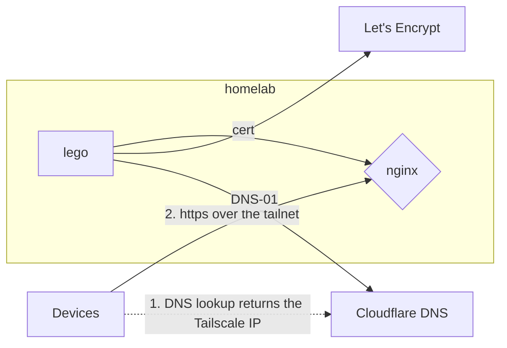
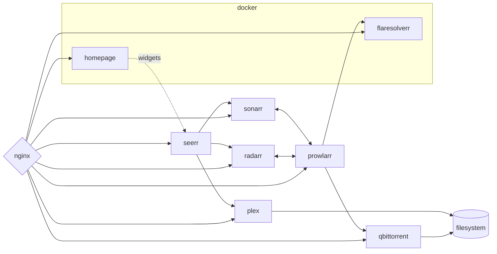

# homelab
Dashboard: https://lab.alexyoung.io (tailnet only). Each service is at `https://<service>.lab.alexyoung.io`.

## Setup
```
$ ./init.sh   # install apps, link configs (uses sudo)
$ cp .env.example .env   # fill in Homepage widget keys
$ $EDITOR ~/.config/homelab/cloudflare.env   # CF_DNS_API_TOKEN=... (Zone:DNS:Edit + Zone:Read on alexyoung.io), chmod 600
$ ./start.sh
```
## Moving to a new machine
Needs an Apple Silicon Mac. Everything is in this repo except app state (databases, API keys, tokens) and media, which sits on the `Lucy` drive.

On the old machine, keep the archive off the Mac and private (it holds API keys and tokens):
```
$ ./state.sh backup /Volumes/Lucy/Backups/homelab
```
Run it from the main checkout so it picks up `.env`. Run it again before every move.

On the new machine:
1. Install Homebrew and the Xcode command line tools, clone this repo, install the Tailscale app (installed by `init.sh`) and sign in.
2. `./init.sh`: installs Homebrew packages, the apps and Seerr. Open Docker Desktop once so it finishes setup.
3. `./state.sh restore <archive>` with everything stopped. This puts back each app's settings (bind addresses, auth, libraries), Seerr's database, `.env`, the Plex preferences and `~/.config/homelab/cloudflare.env`.
4. Plug in `Lucy` (same volume name, or the library paths break) and approve any macOS prompts for access to it.
5. Point the `lab` and `*.lab` A records in Cloudflare at the new `tailscale ip -4`.
6. `./start.sh`. lego issues the wildcard cert on first run.

Stop the old machine first: the restored Plex keeps the same server identity, so two running copies conflict. Plex's Metadata and Media (artwork, thumbnails) aren't backed up (`PLEX_FULL=1` includes them); Plex re-downloads them, so the first library scan is slow.

## Helpful Commands
### Tail Logs
```
$ tail -f ~/Library/Application\ Support/Radarr/logs/radarr.debug.txt
```
### Test DNS
```
$ dig +short seerr.lab.alexyoung.io   # expect the homelab's Tailscale IP
```
### Restart a service
```
$ launchctl kickstart -k gui/$(id -u)/com.homelab.<service>
```
### Update Plex
Auto-update is off (it relaunches Plex outside launchd). Install the new version over the old one, then restart `com.homelab.plex`.
### Update Seerr
Bump `version` in `init.sh`'s `seerr()`, then:
```
$ cp -Rp /opt/seerr/config ~/seerr-config-backup
$ cd /opt/seerr && git fetch --tags && git checkout vX.Y.Z
$ CYPRESS_INSTALL_BINARY=0 pnpm install --frozen-lockfile && pnpm build
$ launchctl kickstart -k gui/$(id -u)/com.homelab.seerr
```
## Architecture
External: how a device reaches the homelab, and where the cert comes from.

Internal: what nginx fronts, and how the services talk to each other.

## Troubleshooting
- **Blank Plex Web page / truncated downloads:** nginx can't write `/opt/homebrew/var/run/nginx/*_temp` (left owned by `nobody` after a root-run nginx). `rmdir` those empty dirs and `nginx -s reload`. Never run nginx with `sudo`.
- **Plex app can't reach the server away from home:** Tailscale must be on; the app connects via `https://plex.lab.alexyoung.io:443` (Plex → Network → Custom server access URLs). Fully close and reopen the app after changing it.
- **Plex iOS search only shows the library:** enable Movies & Shows under the account's Settings → Online Media Sources.
- **Seerr "Sign in with Plex" spins forever on iPhone:** iOS pauses the original tab, so the pop-up never reaches plex.tv. Switch back to the first tab for a few seconds, allow pop-ups, or sign in with a Seerr password instead.
