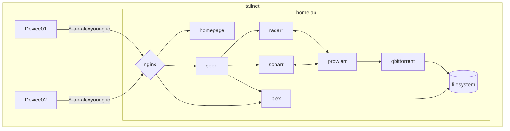

# homelab
Dashboard: https://lab.alexyoung.io (tailnet only). Each service is at `https://<service>.lab.alexyoung.io`.

## Setup
```
$ ./init.sh   # install apps, link configs (uses sudo)
$ cp .env.example .env   # fill in Homepage widget keys
$ $EDITOR ~/.config/homelab/cloudflare.env   # CF_DNS_API_TOKEN=... (Zone:DNS:Edit + Zone:Read on alexyoung.io), chmod 600
$ ./start.sh
```
## Helpful Commands
### Tail Logs
```
$ tail -f ~/Library/Application\ Support/Radarr/logs/radarr.debug.txt
```
### Test DNS
```
$ dig +short seerr.lab.alexyoung.io   # expect the homelab's Tailscale IP
```
## Architecture

