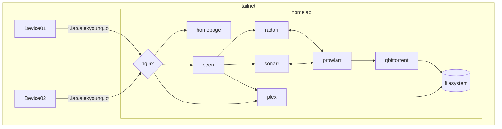

# homelab
Dashboard: https://lab.alexyoung.io (tailnet only). Each service is at `https://<service>.lab.alexyoung.io`.

## Setup
```
$ ./init.sh   # install apps, link configs (uses sudo)
$ cp .env.example .env   # fill in Homepage widget keys
$ $EDITOR ~/.config/homelab/cloudflare.env   # CF_DNS_API_TOKEN=... (Zone:DNS:Edit + Zone:Read on alexyoung.io), chmod 600
$ ./start.sh
```
## Helpful Commands
### Tail Logs
```
$ tail -f ~/Library/Application\ Support/Radarr/logs/radarr.debug.txt
```
### Test DNS
```
$ dig +short seerr.lab.alexyoung.io   # expect the homelab's Tailscale IP
```
### Restart a service
```
$ launchctl kickstart -k gui/$(id -u)/com.homelab.<service>
```
### Update Plex
Auto-update is off (it relaunches Plex outside launchd). Install the new version over the old one, then restart `com.homelab.plex`.
### Update Seerr
Bump `version` in `init.sh`'s `seerr()`, then:
```
$ cp -Rp /opt/seerr/config ~/seerr-config-backup
$ cd /opt/seerr && git fetch --tags && git checkout vX.Y.Z
$ CYPRESS_INSTALL_BINARY=0 pnpm install --frozen-lockfile && pnpm build
$ launchctl kickstart -k gui/$(id -u)/com.homelab.seerr
```
## Architecture

## Troubleshooting
- **Blank Plex Web page / truncated downloads:** nginx can't write `/opt/homebrew/var/run/nginx/*_temp` (left owned by `nobody` after a root-run nginx). `rmdir` those empty dirs and `nginx -s reload`. Never run nginx with `sudo`.
- **Plex app can't reach the server away from home:** Tailscale must be on; the app connects via `https://plex.lab.alexyoung.io:443` (Plex → Network → Custom server access URLs). Fully close and reopen the app after changing it.
- **Plex iOS search only shows the library:** enable Movies & Shows under the account's Settings → Online Media Sources.
- **Seerr "Sign in with Plex" spins forever on iPhone:** iOS pauses the original tab, so the pop-up never reaches plex.tv. Switch back to the first tab for a few seconds, allow pop-ups, or sign in with a Seerr password instead.
